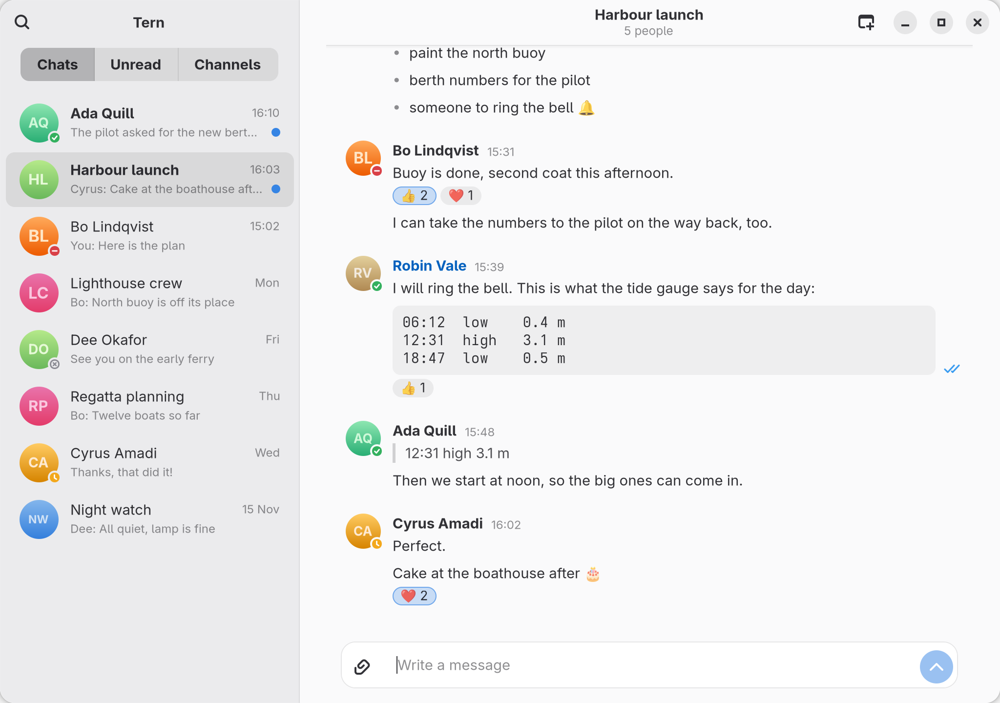
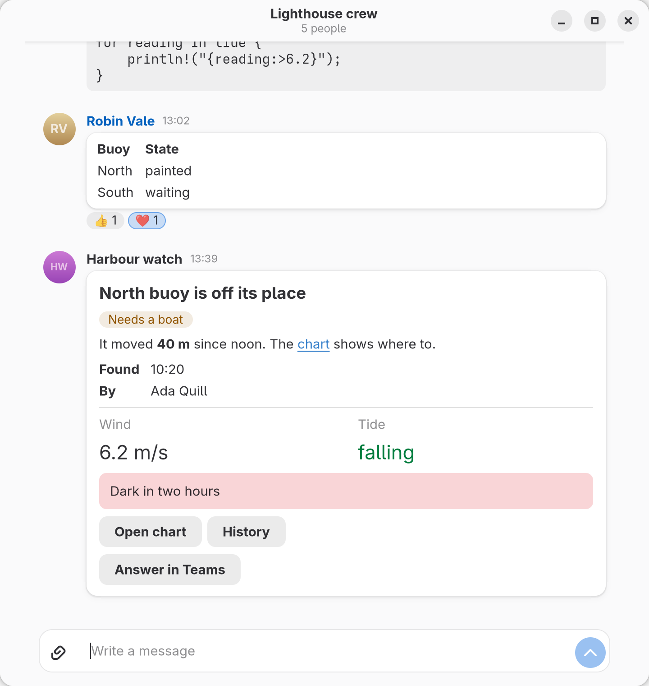
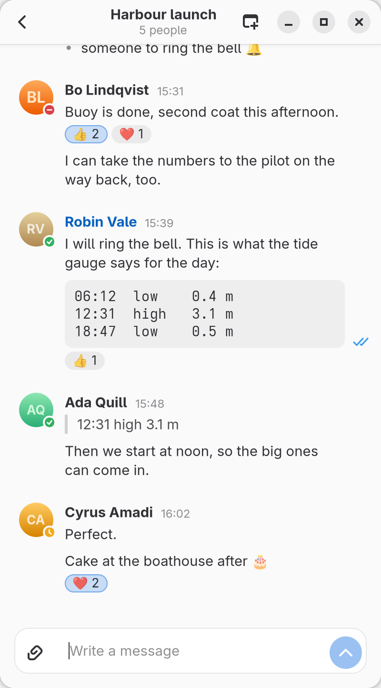
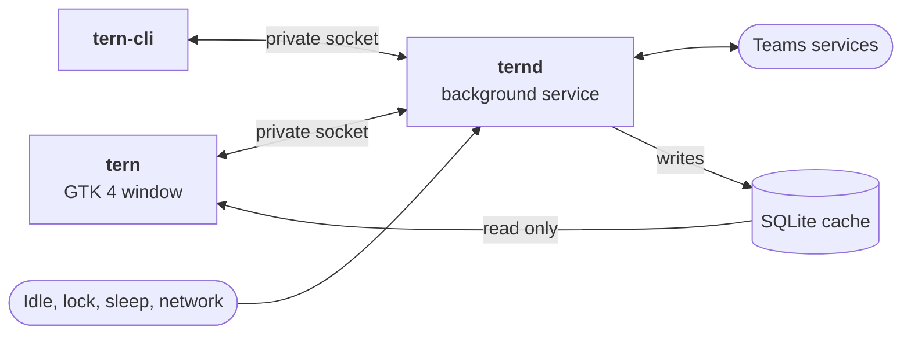

<div align="center">


# Tern

**A native Microsoft Teams client for Linux.**<br>
GTK 4 and Rust. Works offline. Knows when you are really there.

[](https://github.com/rhgrieve/tern/actions/workflows/build.yml)
[](LICENSE)


[Try it](#try-it) · [What works](#what-works) · [Privacy](#privacy-and-safety) · [How it is built](#how-it-is-built) · [Building](#building)

<picture>
  <source media="(prefers-color-scheme: dark)" srcset="docs/images/window-dark.png">
  
</picture>

</div>

> [!IMPORTANT]
> Tern is unofficial, early, and not affiliated with Microsoft. It uses the undocumented services
> Teams itself uses. They can change at any time, and your organization may not allow it: ask
> whoever looks after your Teams before you sign in.

## Why

Teams in a browser tab cannot see the computer it runs on. Work in another window for five minutes
and your colleagues see **Away**. It caches little, so it is slow to open and useless on a train.

Tern is not a wrapped web page. A small background service watches for keyboard and pointer input
through your desktop, keeps your messages on disk, and stays connected whether a window is open or
not. The window is native widgets from top to bottom; a browser engine is used for signing in, and
for nothing else.

## What works

| | |
|---|---|
| **Presence that is true** | Input in any app keeps you Available. Away after 5 minutes without it, at once when you lock, and before sleep. A status you set yourself always wins. It reports what you do; it does not pretend |
| **Offline** | Chats and channels are kept on your computer. Read and search them without a network |
| **Sending** | Messages queue until they can be sent, and are sent once. What fails comes back to you |
| **Conversations** | Chats, channels and threads; pinned chats; replies, edits, reactions, mentions, `@Everyone`, pictures, files, link previews, `:emoji:`, spell checking, drafts, who is writing |
| **Who is there** | Other people's status on their faces, as it changes |
| **Receipts** | One check while your newest message is on its way, two when it arrived, blue when it was read. Point at it to see by whom |
| **Windows** | Any chat can have its own (Ctrl+Shift+O, or a double click). One pane when narrow. Made for tiling, too |
| **Cards** | Adaptive Cards are shown. Answering one opens Teams |
| **Notifications** | For messages, mentions and reactions to yours. With actions and replies, where your desktop offers them. A tray icon with your status and unread chats |
| **Calendar** | Today and the two weeks ahead, also offline. Reminders when you set them in Teams, and as a meeting begins |
| **Meetings** | Join takes you in with sound, muted; for video and sharing it opens the meeting in a browser window of its own, with a profile just for Teams. Opens `msteams:` links; installing can make Tern the default for them if you have not chosen an app |
| **Calls** | Call from a 1:1 or group chat, with sound; mute and hang up from a bar in every window. Answer or decline when somebody calls. Shows calls you missed. Video is for Teams in the browser, or another device |
| **Keyboard and screen readers** | Everything is reachable; Ctrl+K searches, Ctrl+? lists the keys |

<div align="center">
<picture>
  <source media="(prefers-color-scheme: dark)" srcset="docs/images/card-dark.png">
  
</picture>
&nbsp;
<picture>
  <source media="(prefers-color-scheme: dark)" srcset="docs/images/narrow-dark.png">
  
</picture>
</div>

<div align="center"><sub>Everyone in these pictures is invented: <code>tern --demo</code></sub></div>

**Next:** calls in Tern itself.

## Try it

Everything is on [Releases](https://github.com/rhgrieve/tern/releases), for 64-bit Intel and AMD
computers. You also need a keyring such as GNOME Keyring or KWallet.

| | Runs on | Service | Good for |
|---|---|---|---|
| **Flatpak** | Any distribution with Flatpak and Flathub | Started by the window, and at login if your desktop allows it | Most people |
| **AppImage** | Ubuntu 26.04, Fedora 43 and 44, Arch | Started by the window; ends when you log out | Having a look |
| **Archive** | The same | A systemd service | Keeping it |

**Flatpak**

```sh
flatpak install --user --or-update ./tern-*-x86_64.flatpak
```

**AppImage**

```sh
chmod +x tern-*-x86_64.AppImage
./tern-*-x86_64.AppImage              # or with --install, to keep it like the archive
```

**Archive**

```sh
tar xzf tern-*-x86_64.tar.gz
cd tern-*-x86_64
./install.sh                          # for you only, in ~/.local; a newer one updates it
```

Then open **Tern** and choose *Sign In*. Only curious? `--demo` needs no account. Use one of the
three at a time: each has its own sign-in or service, and two would both report your presence.

| | Archive | AppImage | Flatpak |
|---|---|---|---|
| Is it well? | `tern-cli status` | `--cli status` | `flatpak run --command=tern-cli io.github.rhgrieve.Tern status` |
| Remove it | `./uninstall.sh` | delete it | `flatpak uninstall io.github.rhgrieve.Tern` |

Sign out first (`tern-cli logout`) when you remove it; `uninstall.sh` does.

The AppImage and the archive use your system's GTK, libadwaita 1.8 and WebKitGTK 6.0 rather than
bring their own: the page you type your password into should get its security updates, and keep its
sandbox. The Flatpak gets them from the GNOME runtime.

Spell checking needs a dictionary for your language, e.g. `hunspell-en-ca` on Ubuntu,
`hunspell-en-CA` on Fedora, or `hunspell hunspell-en_ca` on Arch. The Flatpak has its own.

Passkeys may not work for signing in. Automatic presence needs a Wayland desktop with
`ext-idle-notify-v1`, or GNOME. When you report a problem, please do not paste `tern-cli tail`,
`read` or `chats`: they show messages.

## Privacy and safety

- The refresh token lives in your desktop keyring; access tokens only in memory. A token is only
  sent to the service it was issued for.
- The cache holds message text, in `~/.local/share/tern`, readable only by you. It is not encrypted
  by itself, and signing out keeps it. Pictures and files take at most 1 GB each.
- Only pictures Teams itself stores are fetched ahead. Anything else would tell its owner when you
  received a message. The same goes for pictures in cards. Link previews come from Teams, which
  looks at the page itself; sending a link asks Teams for one.
- Windows and service talk over a private socket, not D-Bus, so that other apps cannot send
  messages as you by asking for it on the bus.
- The sign-in window takes the redirect before the page loads. Pasting that address from a browser
  is deliberately not supported, because that is how sign-in codes get phished.

## How it is built



| Program | What it does |
|---|---|
| `tern` | The window. `tern --demo` shows it with invented people |
| `ternd` | The service: presence, sync, sending, notifications, tray |
| `tern-login` | The sign-in window, the only part with a browser engine (WebKitGTK) |
| `tern-cli` | `login`, `logout`, `whoami`, `status`, `chats`, `read`, `search`, `files`, `get`, `send`, `tokens`, `tail`, `sensors`, `probe-sync` |

Idle comes from Wayland's `ext-idle-notify-v1`, or from GNOME over D-Bus; a playing video does not
count as activity. Lock and sleep come from logind. Window managers see chat windows as
`io.github.rhgrieve.Tern.Chat`.

## Building

Rust 1.100, and the development files of GTK 4, libadwaita 1.8 and WebKitGTK 6.0.

```sh
cargo run --release -p tern -- --demo     # no account needed
cargo test --workspace
cargo build --release --workspace && packaging/install.sh
packaging/archive.sh && packaging/flatpak.sh && packaging/appimage.sh
```

<details>
<summary>More for working on it</summary>

```sh
TERN_INSTANCE=dev TERN_NO_PRESENCE=1 ternd      # beside the installed service
cargo run -p tern-cli -- sensors                # watch detection, no account needed
cargo run --release -p tern --example scroll    # 10,000 messages, on a real display
cargo run --release -p tern --example opening   # what opening chats costs
```

Every change is checked, built and started on the supported systems by
[GitHub Actions](.github/workflows/build.yml). A tag like `v0.1.0` publishes what `main`'s build of that commit made.

</details>

## Thanks

`vendor/engine` is from [rusty-teams](https://github.com/danieldaeschle/rusty-teams) (MIT), with the
changes listed in [`PATCHES.md`](vendor/engine/PATCHES.md).

Tern is [MIT licensed](LICENSE). Microsoft and Teams are trademarks of Microsoft.
